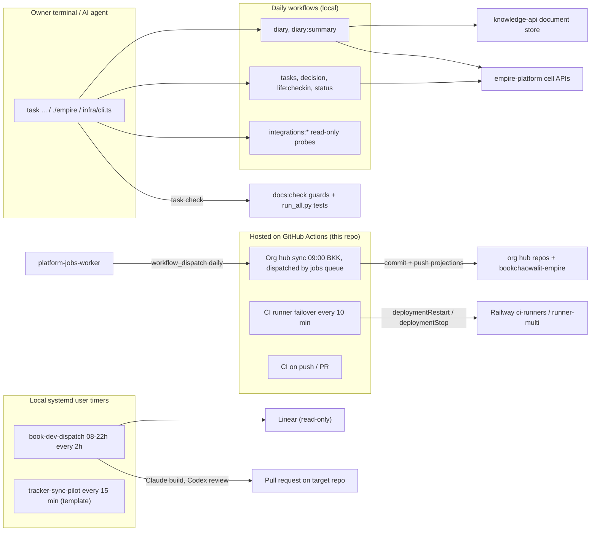
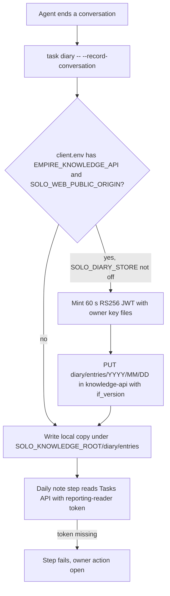

# 01 — Business process (As-Is / To-Be)

platform-ops-cli (ชื่อเดิมใน README: `ops-toolkit`) **ไม่ใช่ service ที่ deploy** (`PRODUCT.md` §Operating Context) เป็น monorepo ของ Python scripts + owner CLI (`infra/cli.ts`) + Task adapters ที่เจ้าของและ AI agent เรียกจาก terminal และมี 3 workflows ที่รันบน GitHub Actions บน GitHub Actions ของ repo นี้เอง
งานหลักในวันนี้แบ่งได้ 5 กลุ่ม: (1) daily workflows ที่อ่าน/เขียน cell APIs (tasks, goals, habits, diary …), (2) org hub registry sync, (3) Book Dev Linear dispatch (AI build → review → PR), (4) CI runner hosting (image + failover watchdog), (5) offline tests และ contract guards (`task check`)

## As-Is (จากโค้ดวันนี้)

Sources: `README.md`, `PRODUCT.md`, `Taskfile.yml`, commit `5fdb2d9`, `infra/tasks/operations.yml`, `infra/tasks/portfolio.yml`, `.github/workflows/org-hub-sync.yml`, `.github/workflows/ci-runner-failover.yml`, `.github/workflows/ci.yml`, `infra/scripts/workflows/install_book_dev_dispatch_timer.py`, `infra/templates/tracker-sync/tracker-sync-pilot.timer`, `infra/scripts/workflows/daily_diary.py`, `infra/scripts/utils/knowledge_store.py`, `docs/operations/book-dev-linear-dispatch.md`

### As-Is: daily diary (กระบวนการที่ทำบ่อยที่สุด)

Sources: `infra/scripts/workflows/daily_diary.py`, `infra/scripts/utils/knowledge_store.py`, `README.md` §Diary, `PRODUCT.md` §Capabilities, ops record: hosted-document-store (2026-11-03)

## To-Be

repo นี้ไม่มี `specs/` หรือ `docs/UPGRADE-PLAN.md` To-Be ที่มีในเอกสาร repo มีเพียง:

- `PRODUCT.md` §Measures: `task test:strict` บน `main` ต้องมี skip/partial = 0 นอกกรณี sibling-checkout ที่ระบุไว้, ทุก release ของ 4 core targets ต้องมี quality evidence (ทั้งสอง task ยังไม่มีใน Taskfile ดู [03](03-user-flows.md)), diary ต้องบันทึกทุกวันทำงานเมื่อ `reporting-reader` ถูกตั้ง [ต้องยืนยัน]
- `docs/operations/book-dev-linear-dispatch.md`: timer จะเริ่มส่งงานได้จริงเมื่อมี `LINEAR_API_KEY` (read-only) ใน Infisical `/linear`
- `infra/ci-runner/README.md`: failover จะ switch จริงเมื่อเจ้าของตั้ง `RAILWAY_TOKEN` ใน environment `ci-runner-failover`
- `docs/superpowers/specs/2026-10-14-tracker-sync.md`: tracker sync pilot เปิดใช้เมื่อ credential preflight ผ่าน

## Open questions

- PRODUCT.md บอก "Out of scope: hosted schedulers" แต่ repo มี scheduled workflows 2 ตัว (org hub sync, CI runner failover): ควรแก้ PRODUCT.md หรือย้ายงาน
- To-Be ระดับ product (เช่น จะย้าย daily workflows ขึ้น hosted หรือไม่) ไม่มีในเอกสาร repo
