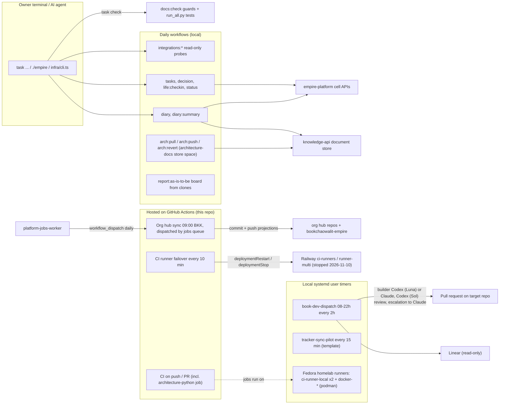
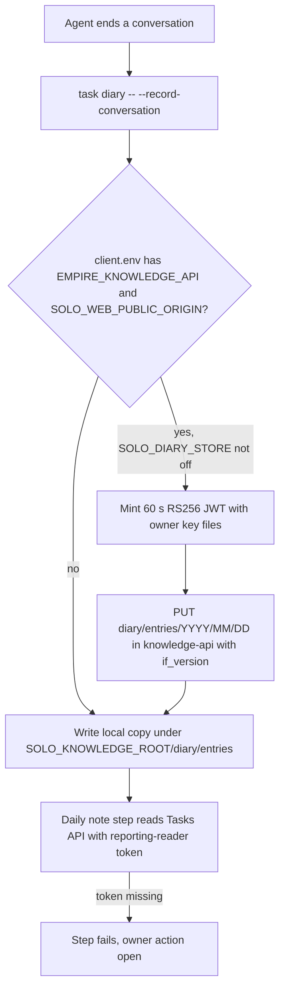

# 01 — Business process (As-Is / To-Be)

platform-ops-cli (ชื่อเดิมใน README: `ops-toolkit`) **ไม่ใช่ service ที่ deploy** (`PRODUCT.md` §Operating Context) เป็น monorepo ของ Python scripts + owner CLI (`infra/cli.ts`) + Task adapters ที่เจ้าของและ AI agent เรียกจาก terminal และมี 3 workflows ที่รันบน GitHub Actions บน GitHub Actions ของ repo นี้เอง
งานหลักในวันนี้แบ่งได้ 6 กลุ่ม: (1) daily workflows ที่อ่าน/เขียน cell APIs (tasks, goals, habits, diary …), (2) org hub registry sync, (3) Book Dev Linear dispatch (AI build → review → PR), (4) CI runner hosting (image + failover watchdog), (5) offline tests และ contract guards (`task check`), (6) เครื่องมือเอกสารสถาปัตยกรรม (`task arch:*`) และรายงาน As-Is / To-Be (`task report:as-is-to-be`)

Last reviewed: 2026-11-27 · commit `524c52d`

## As-Is (จากโค้ดวันนี้)

Sources: `README.md`, `PRODUCT.md`, `Taskfile.yml`, commit `524c52d`, `infra/tasks/operations.yml`, `infra/tasks/portfolio.yml`, `architecture/Taskfile.yml`, `infra/scripts/workflows/book_dev_ai_dispatch.py`, `infra/ci-runner/README.md`, `infra/ci-runner/local/runners-docker.txt`, `.github/workflows/org-hub-sync.yml`, `.github/workflows/ci-runner-failover.yml`, `.github/workflows/ci.yml`, `infra/scripts/workflows/install_book_dev_dispatch_timer.py`, `infra/templates/tracker-sync/tracker-sync-pilot.timer`, `infra/scripts/workflows/daily_diary.py`, `infra/scripts/utils/knowledge_store.py`, `docs/operations/book-dev-linear-dispatch.md`

### As-Is: daily diary (กระบวนการที่ทำบ่อยที่สุด)

Sources: `infra/scripts/workflows/daily_diary.py`, `infra/scripts/utils/knowledge_store.py`, `README.md` §Diary, `PRODUCT.md` §Capabilities, ops record: hosted-document-store (2026-11-03)

## To-Be

repo นี้ไม่มี `specs/` หรือ `docs/UPGRADE-PLAN.md` To-Be ที่มีในเอกสาร repo มีเพียง:

- `PRODUCT.md` §Measures: `task test:strict` บน `main` ต้องมี skip/partial = 0 นอกกรณี sibling-checkout ที่ระบุไว้, ทุก release ของ 4 core targets ต้องมี quality evidence (`task test:strict` และ `task quality:core` ยังไม่มีใน Taskfile ที่ `524c52d`, `task check` เรียก `test` ดู [03](03-user-flows.md)), diary ต้องบันทึกทุกวันทำงาน (`reporting-reader` ตรวจแล้ว 2026-11-18 ตาม `PRODUCT.md`; ใช้ `task diary:hosted`)
- `docs/operations/book-dev-linear-dispatch.md`: timer จะเริ่มส่งงานได้จริงเมื่อมี `LINEAR_API_KEY` (read-only) ใน Infisical `/linear`
- `infra/ci-runner/README.md`: failover จะ switch จริงเมื่อเจ้าของตั้ง `RAILWAY_TOKEN` ใน environment `ci-runner-failover`
- `docs/superpowers/specs/2026-10-14-tracker-sync.md`: tracker sync pilot เปิดใช้เมื่อ credential preflight ผ่าน

## Gap

| ID | As-Is → To-Be | Status | Owner | Evidence |
|---|---|---|---|---|
| G1 | Book Dev dispatch timer idle → sends Linear tickets to the configured builder (Codex Luna on the owner machine since 2026-11-09) + Codex Sol review, escalation to Claude | blocked | owner | `docs/operations/book-dev-linear-dispatch.md` (Codex builder, Sol review, `INFISICAL_CLI_ENABLED=1`, `infra/scripts/workflows/install_book_dev_dispatch_timer.py`); tickets still need the `ai-dispatch` label (ops record: book-dev-build-review-flow, 2026-11-09); whether the timer runs today is not visible from code [ต้องยืนยัน] |
| G2 | CI runner failover can switch only with `RAILWAY_TOKEN` (workflow warns and switches nothing when unset); CI runs on Fedora local runners, Railway runner-multi stopped → owner decides whether failover to Railway stays | decide | owner | `.github/workflows/ci-runner-failover.yml`, `infra/ci-runner/README.md` (Fedora host 2026-11-10, Railway stopped); ops record: ci-hosting-policy (2026-11-10) |
| G3 | tracker sync template, no active timer in the repo → pilot on after credential preflight | blocked | owner | `docs/superpowers/specs/2026-10-14-tracker-sync.md`, `infra/templates/tracker-sync/tracker-sync-pilot.timer`, `infra/platform/tracker-sync-pilot.json`; no change since commit `8986913` |
| G4 | `task check` runs `test`; `test:strict` and `quality:core` are not in the Taskfile → `task test:strict` with skip = 0 and release evidence | todo | claude | `PRODUCT.md` §Measures and `README.md` describe `test:strict`; `Taskfile.yml` `check` calls `test` at `524c52d` |

## Open questions

- To-Be ระดับ product (เช่น จะย้าย daily workflows ขึ้น hosted หรือไม่) ไม่มีในเอกสาร repo
- `docs/diagrams/01-business-process.md` ของ repo นี้ครอบคลุม root เท่านั้น ส่วน `architecture/` เป็นเครื่องมือย่อยที่ยังไม่มีไฟล์ As-Is ของตัวเอง [ต้องยืนยัน] ว่าต้องมีหรือไม่
