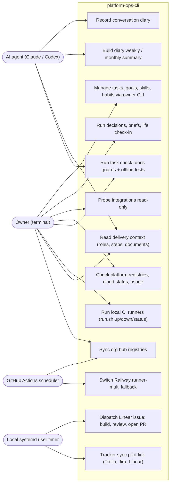

# 02 — Use cases

Actors คือผู้เรียกจริงตามโค้ด: เจ้าของจาก terminal, AI agent ที่ shell out มาที่ scripts (`SOLO_OPS_ROOT`), GitHub Actions scheduler และ local systemd timer
สิทธิ์ต่อ cell ไม่ได้มาจาก login ของคน แต่มาจาก **automation token ต่อหน้าที่** (`EMPIRE_AUTOMATION_TOKEN_<NAME>` หรือ `.runtime/automation-tokens/<name>.jwt`) ชื่อที่พบในโค้ด: `owner-cli`, `reporting-reader`, `portfolio-reader`, `governance-reader`, `engagement-reader`, `cron-runner`, `decision-engine`, `email-pipeline`, `role-router`, `role-evidence`

| Actor | Token / credential ที่ใช้ | ตัวอย่าง use case |
|---|---|---|
| Owner | `owner-cli` (cell store ใน `infra/cli.ts`), CRM owner token, `gh` login, Infisical CLI | UC1, UC6, UC12 |
| AI agent | `reporting-reader` (diary note), owner key files สำหรับ knowledge JWT | UC2, UC3 |
| GitHub Actions | env secret `ORG_HUB_SYNC_TOKEN` (env `org-hub-sync`), `RAILWAY_TOKEN` + `CI_FAILOVER_GH_TOKEN` (env `ci-runner-failover`) | UC8, UC9 |
| Local timer | `LINEAR_API_KEY` จาก secret resolver, Claude/Codex/gh login บนเครื่อง | UC10, UC11 |

Sources: `PRODUCT.md` §Users, `infra/cli.ts` (`cellStore(... 'owner-cli')`), `infra/scripts/utils/task_store.py` (`TOKEN_DIR`), `infra/scripts/utils/cell_store.py`, `grep open_cell_store infra/scripts`, `.github/workflows/org-hub-sync.yml`, `.github/workflows/ci-runner-failover.yml`, `infra/scripts/workflows/book_dev_linear_cycle.py`, `infra/scripts/sync/tracker_sync.py`, `infra/ci-runner/local/run.sh`, `README.md` §Delivery definitions

## Open questions

- การ map token → scope ฝั่ง server อยู่ใน empire-platform ไม่ใช่ repo นี้: ไม่ได้ยืนยันว่าแต่ละ token มีสิทธิ์ตรงตามชื่อ
- Tracker sync pilot (UC11) ติดตั้ง timer แล้วหรือยัง: repo มีแค่ template และ installer ที่รอ preflight
