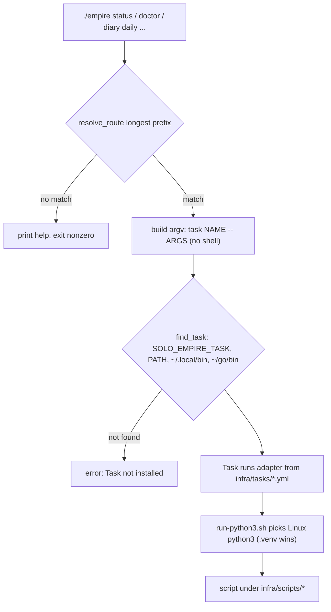
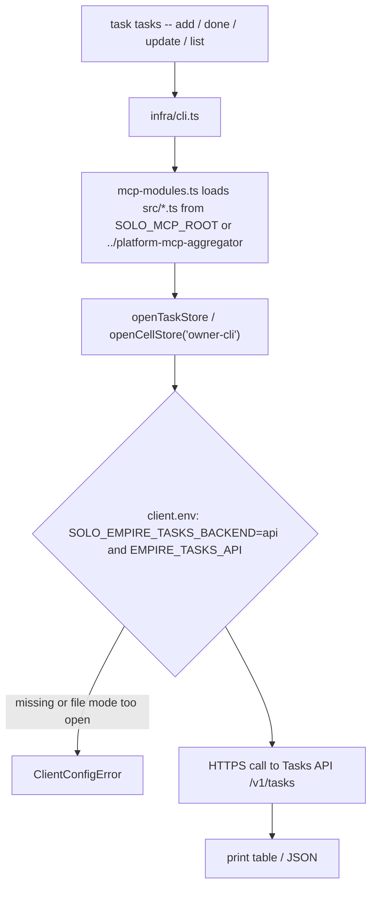
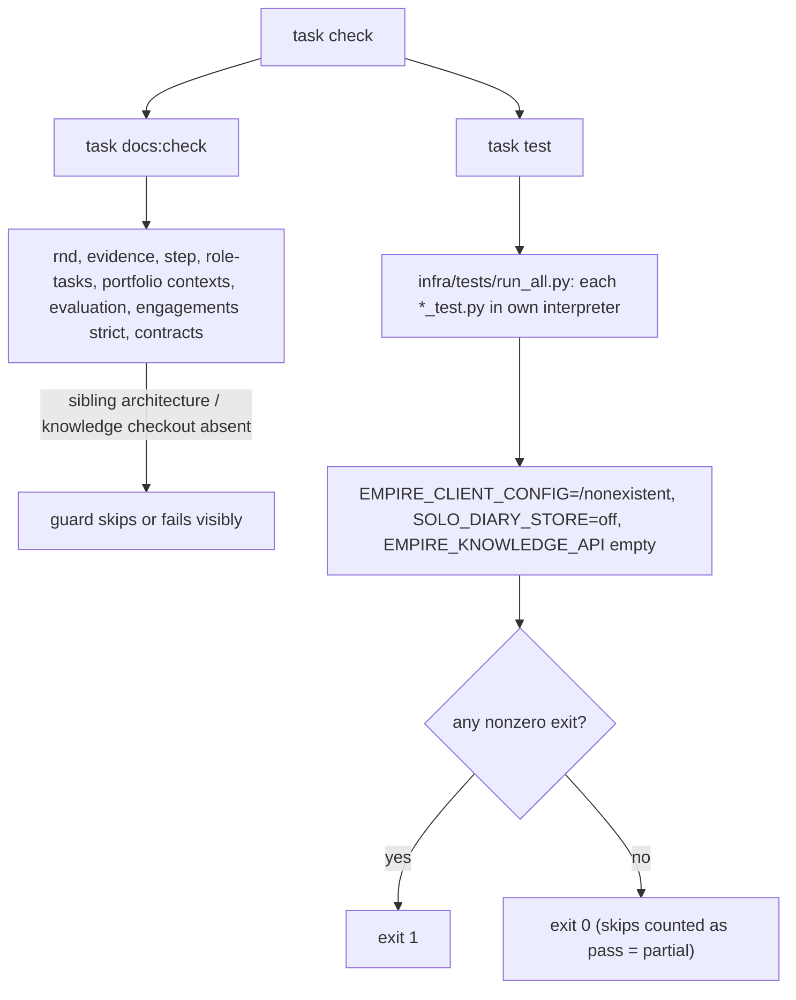
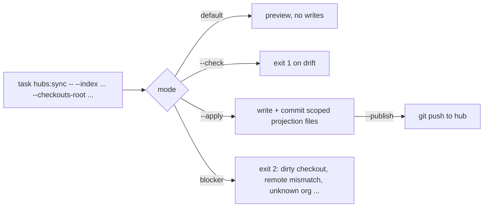

# 03 — User flows

repo นี้เป็น CLI จึงไม่มี pages/routes flow ต่อ role คือเส้นทางคำสั่ง: `./empire <words>` → `task <name>` → Python script / `infra/cli.ts`
`empire` เป็น routing อย่างเดียว (longest-prefix match ใน `ROUTES`) ไม่มี business logic

## Flow 1 — Owner: คำสั่งผ่าน facade

Sources: `empire`, `Taskfile.yml`, `infra/tasks/*.yml`, `infra/scripts/setup/run-python3.sh`, `infra/README.md`

## Flow 2 — Owner: owner CLI tasks

Sources: `infra/cli.ts`, `infra/mcp-modules.ts`, `infra/scripts/utils/task_store.py`, `infra/scripts/utils/tasks_backend.py`

## Flow 3 — Owner: local verification gate (ที่มีจริงใน Taskfile)

Sources: `Taskfile.yml` (`check`, `docs:check`, `test`), `infra/tests/run_all.py`

**ข้อค้นพบ:** `README.md` §Quality gate, `PRODUCT.md` และ `docs/core-quality.md` อธิบาย `task test:strict` และ `task quality:core` (evidence `.runtime/quality/core-latest.json`) แต่ใน `Taskfile.yml` และ `infra/tasks/*.yml` ไม่มี task ทั้งสองชื่อ และไม่มีสคริปต์ใดใน repo ที่เขียน `core-latest.json` README ยังบอกว่า `task check` ใช้ `test:strict` ขณะที่ `Taskfile.yml` เรียก `task: test` จึงวาดเฉพาะ flow ที่มีจริง

## Flow 4 — Owner: org hub sync (manual / hosted)

Sources: `docs/operations/org-hub-registry-sync.md`, `infra/scripts/sync/org_hub_registry.py`, `.github/workflows/org-hub-sync.yml`

Flow ของ Book Dev dispatch (timer) อยู่ใน [10-sequences.md](10-sequences.md) และตารางขั้นตอนเดิมใน [`docs/operations/book-dev-linear-dispatch.md`](../operations/book-dev-linear-dispatch.md) (reused)

## Open questions

- `task quality:core` / `task test:strict` หายไปตอน split จาก hub (2026-10-11) หรืออยู่ repo อื่น: ต้องคืน task หรือแก้ README/PRODUCT.md/`docs/core-quality.md`
- `task tasks -- sync|push|pull` ใน `infra/cli.ts` เรียก `go run` ใน `infra/go/task-sync` ซึ่งไม่มีใน repo: flow นี้ใช้ไม่ได้ในวันนี้ ควรลบหรือชี้ไป repo อื่น
