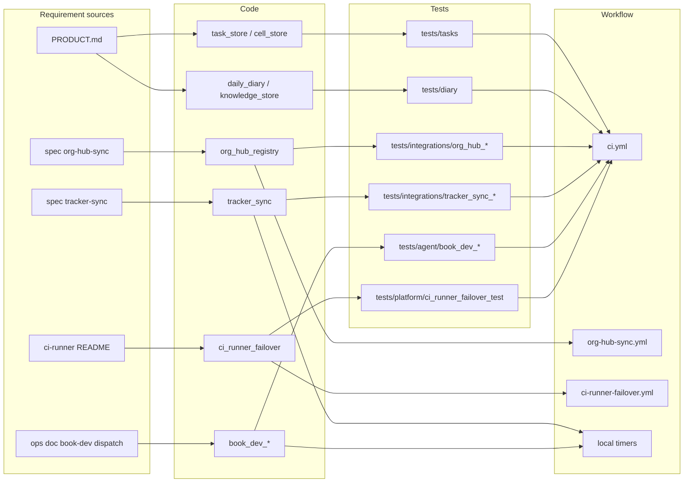

# 04 — Traceability (RTM)

แหล่ง requirement ใน repo: `PRODUCT.md` (capabilities / constraints), specs ใน `docs/superpowers/specs/` (tracker sync 2026-10-14, org hub sync 2026-10-15) และ operations docs ใน `docs/operations/`
repo ไม่มี requirement ID ทางการ จึงตั้ง ID ชั่วคราว `R-xx` ในตารางนี้ (ใช้อ้างอิงภายใน pack เท่านั้น)
"Release" ของ repo นี้คือ push เข้า `main` (ไม่มี deploy, ดู [16](16-deployment.md)); gate คือ `.github/workflows/ci.yml`

| ID | Requirement (source) | Code module | Test file | Release / workflow |
|---|---|---|---|---|
| R-01 | Tests รัน offline ไม่แตะ production API (`PRODUCT.md`, `README.md`) | `infra/tests/run_all.py` | ทุก `infra/tests/**/*_test.py`; `infra/tests/quality/smoke_test.py` | `ci.yml` job `infra-python` |
| R-02 | Writers ใช้ Tasks API ผ่าน store เดียว, SQLite retired (`task_store.py` docstring) | `infra/scripts/utils/task_store.py` | `infra/tests/tasks/*_task_store_test.py`, `task_writer_guard_test.py`, `client_config_test.py` | `ci.yml` |
| R-03 | Cell clients https only, ไม่ follow redirect (`cell_store.py`) | `infra/scripts/utils/cell_store.py` | `infra/tests/platform/cell_probe_test.py` | `ci.yml` |
| R-04 | Diary ไม่เก็บ raw prompt/response/secret (`PRODUCT.md`) | `infra/scripts/workflows/daily_diary.py`, `diary_summary.py`, `utils/knowledge_store.py` | `infra/tests/diary/daily_diary_test.py`, `diary_store_test.py`, `diary_summary_test.py` | `ci.yml` |
| R-05 | Org hub sync: preview / check / apply / publish, exit 1 drift, exit 2 blocker (`docs/superpowers/specs/2026-10-15-org-hub-sync.md`) | `infra/scripts/sync/org_hub_registry.py` | `infra/tests/integrations/org_hub_registry_test.py`, `org_hub_timer_test.py` | `org-hub-sync.yml` (daily) |
| R-06 | Tracker sync pilot: allowlist, If-Match, journal recovery, dry-run default (`docs/superpowers/specs/2026-10-14-tracker-sync.md`) | `infra/scripts/sync/tracker_sync.py`, `tracker_sync_http.py` | `infra/tests/integrations/tracker_sync_test.py`, `tracker_sync_timer_test.py` | local timer template (ยังไม่ activate) |
| R-07 | Book Dev dispatch: Linear read-only, ≤1 issue/รอบ, ≤2 fix rounds, PR only (`docs/operations/book-dev-linear-dispatch.md`) | `infra/scripts/workflows/book_dev_linear_cycle.py`, `book_dev_ai_dispatch.py`, `book_dev_dispatch_guard.py` | `infra/tests/agent/book_dev_linear_cycle_test.py`, `book_dev_ai_dispatch_test.py`, `book_dev_dispatch_guard_test.py`, `book_dev_execution_hook_test.py`, `book_dev_loop_test.py` | local `book-dev-dispatch` timer |
| R-08 | CI runner failover: start Railway เมื่อ local offline เกิน grace, stop เมื่อ local กลับและ Railway idle (`infra/ci-runner/README.md`) | `infra/scripts/platform/ci_runner_failover.py` | `infra/tests/platform/ci_runner_failover_test.py` | `ci-runner-failover.yml` (*/10) |
| R-09 | Secrets อยู่ใน memory เท่านั้น, ไม่ print (`secret_resolver.py`, `README.md` §Secrets) | `infra/scripts/utils/secret_resolver.py`, `infisical_secrets.py`, `platform/auth_resolver.py` | `infra/tests/security/secret_resolver_test.py`, `infisical_secrets_test.py`, `infra/tests/platform/auth_resolver_test.py` | `ci.yml` + `security` job |
| R-10 | ไม่มี hardcoded secret ใน scripts (`Makefile` lint:secrets) | `infra/scripts/security/scan_secrets.py` | `infra/tests/security/scan_secrets_test.py` | `ci.yml` `security` (gitleaks / Trivy ใน reusable workflow) |
| R-11 | Owner CLI typecheck (`README.md`) | `infra/cli.ts`, `infra/mcp-modules.ts` | — (typecheck เท่านั้น) | `ci.yml` job `infra-node` |
| R-12 | `empire` facade route เท่านั้น (`empire` docstring) | `empire` | `infra/tests/quality/empire_cli_facade_test.py` | `ci.yml` |
| R-13 | Task command ownership / parity (`data/indexes/task-command-ownership.json`) | `infra/scripts/utils/task_command_ownership.py` | `infra/tests/quality/task_command_ownership_test.py` | `ci.yml` (ต้องมี Task binary, pin 3.53.1) |
| R-14 | `task test:strict` / `task quality:core` with evidence (`README.md`, `PRODUCT.md`) | **ไม่พบใน repo** | — | — |
| R-15 | Alerts ส่ง Telegram ผ่าน book_noti_bot (PR #3) | `infra/scripts/utils/alerts.py` | `infra/tests/integrations/alert_delivery_test.py` | `ci.yml` |

Sources: `PRODUCT.md`, `README.md`, `docs/superpowers/specs/2026-10-14-tracker-sync.md`, `docs/superpowers/specs/2026-10-15-org-hub-sync.md`, `docs/operations/book-dev-linear-dispatch.md`, `infra/ci-runner/README.md`, `infra/tests/` (directory listing), `.github/workflows/*.yml`, `Makefile`, `gh pr list` (PR #3)

## Open questions

- ควรมี requirement ID ทางการ (เช่นใน `PRODUCT.md`) หรือไม่ เพื่อให้ RTM ไม่ต้องตั้ง ID ชั่วคราว
- R-14 ไม่มี implementation (ดู [03](03-user-flows.md))
