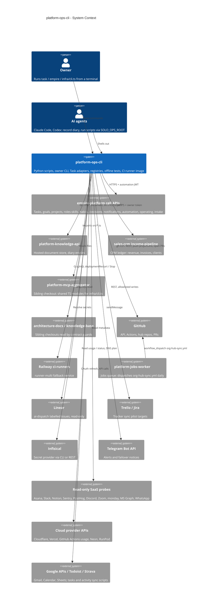

# 05 — C4 Context

platform-ops-cli เป็นกล่องเครื่องมือของเจ้าของ: ไม่มี server ของตัวเอง ทำงานเป็น client ของ cell APIs และ provider APIs และมีงาน schedule บน GitHub Actions

Sources: `README.md`, `PRODUCT.md`, `.github/workflows/org-hub-sync.yml`, commit `5fdb2d9`, `infra/scripts/utils/task_store.py`, `infra/scripts/utils/cell_store.py`, `infra/scripts/utils/knowledge_store.py`, `infra/scripts/utils/crm_ledger.py`, `infra/mcp-modules.ts`, `infra/scripts/sync/*.py` (provider origins), `infra/scripts/platform/ci_runner_failover.py`, `infra/scripts/sync/tracker_sync_http.py`, `infra/scripts/utils/secret_resolver.py`, `infra/scripts/utils/alerts.py`, `infra/scripts/platform/cloudflare_dns.py`, `infra/scripts/platform/vercel_billing.py`, `infra/scripts/platform/github_actions_usage.py`, `infra/scripts/platform/neon_projects.py`, `infra/scripts/utils/_http.py`

## Open questions

- Scripts กลุ่ม Gmail / Todoist / Strava / Google Calendar ยังใช้งานจริงหรือเป็น legacy จาก hub (ไม่มี timer หรือ workflow ที่เรียก)
