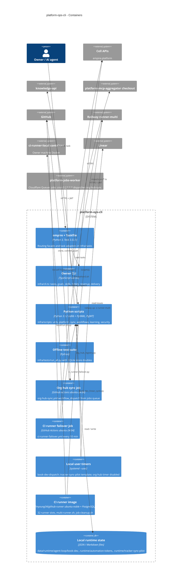

# 06 — C4 Container

"Container" ในที่นี้คือหน่วยที่รันแยกกันจริง: CLI entrypoints บนเครื่องเจ้าของ, scheduled jobs บน GitHub Actions, local timers และ CI runner image ที่ build จาก `infra/ci-runner/`

Sources: `empire`, `Taskfile.yml`, `.task-version`, `infra/cli.ts`, `infra/package.json`, `infra/requirements-dev.txt`, `infra/tests/run_all.py`, `infra/tests/support/`, `.github/workflows/org-hub-sync.yml` (comment on `on:`), commit `5fdb2d9`, `.github/workflows/ci-runner-failover.yml`, `infra/scripts/workflows/install_book_dev_dispatch_timer.py`, `infra/templates/tracker-sync/`, `infra/scripts/sync/install_org_hub_timer.py`, `infra/ci-runner/Dockerfile`, `infra/ci-runner/README.md`, `infra/ci-runner/local/run.sh`, `infra/scripts/utils/task_store.py` (`TOKEN_DIR`), ops record: org-hub-sync-hosted (2026-11-03), ops record: messaging-layer-adr-0008 (2026-11-03)

## Open questions

- ไม่มีไฟล์ระบุ dependency Python ที่ runtime ใช้ (มีแค่ `requirements-dev.txt` และ `requirements-telegram.txt`): ควรมี lock สำหรับ scripts ที่รันบน timer หรือไม่
