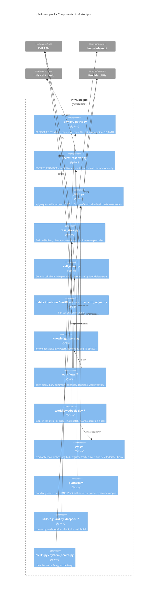
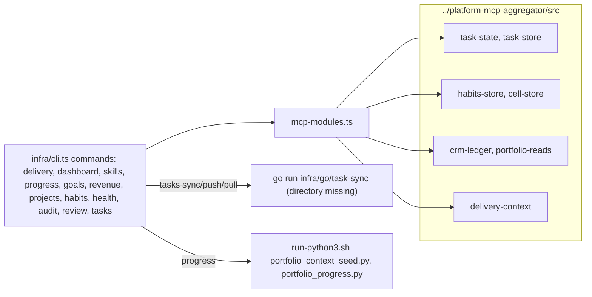

# 07 — C4 Component (Python scripts container)

Component หลักภายใน `infra/scripts/` (โฟลเดอร์ตาม `infra/README.md`) และ module กลางที่ทุก script ใช้ร่วม

Sources: `infra/README.md`, `infra/scripts/utils/_env.py`, `infra/scripts/utils/paths.py`, `infra/scripts/utils/secret_resolver.py`, `infra/scripts/utils/_http.py`, `infra/scripts/utils/task_store.py`, `infra/scripts/utils/cell_store.py`, `infra/scripts/utils/habits_store.py`, `infra/scripts/utils/decision_store.py`, `infra/scripts/utils/notifications_store.py`, `infra/scripts/utils/crm_ledger.py`, `infra/scripts/utils/knowledge_store.py`, `infra/scripts/workflows/`, `infra/scripts/sync/`, `infra/scripts/platform/`, `infra/scripts/utils/alerts.py`, `Taskfile.yml` (`docs:check`)

## Owner CLI (`infra/cli.ts`)

Sources: `infra/cli.ts` (`case` labels, `await mcp(...)`, `runTaskSync`, `runPortfolioProgress`), `infra/mcp-modules.ts`, `README.md` §Delivery definitions

## Open questions

- `runTaskSync` ชี้ไป `infra/go/task-sync` ที่ไม่มีใน repo (ดู [03](03-user-flows.md))
