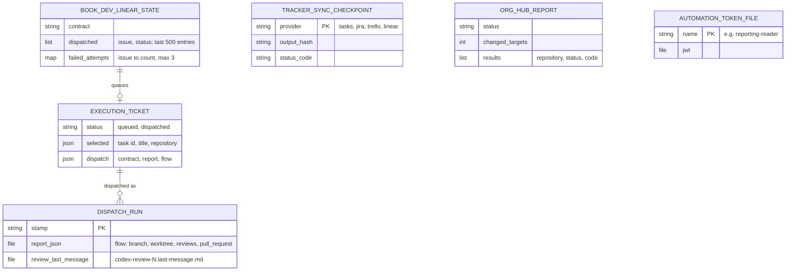

# 09 — ERD

repo นี้ **ไม่มี database ของตัวเอง** ในวันนี้ (SQLite task backend retired 2026-10-09; `DB_PATH` = `data/runtime/operations.db` เป็นค่า nominal ไม่มีไฟล์จริง ตาม `_env.py`) ข้อมูลที่ scripts อ่าน/เขียนอยู่ใน cell APIs ของ empire-platform, CRM ของ sales-crm และ knowledge-api
ภาพแรกคือ **มุมมองฝั่ง client**: resource และ field ที่โค้ดใน repo นี้เรียกจริง ไม่ใช่ schema ที่ authoritative (schema จริงอยู่ใน repo เจ้าของแต่ละ cell)
ภาพที่สองคือ state ที่ repo นี้ persist เองเป็นไฟล์บนเครื่อง

## 1. Remote resources ที่ client ใช้

```mermaid
erDiagram
  TASK {
    int number PK "Tasks API number = old SQLite id"
    string title
    string status "todo, in_progress, done, blocked, cancelled"
    int priority "1-5"
    string project
    string category
    date due_date
    string external_url
    int parent_task_id FK
    int progress_percent
    string notes
  }
  TASK_TYPE {
    int number PK
    string name
    string default_status
    string allowed_statuses
  }
  TASK_LINK {
    int task FK
  }
  TASK_ASSIGNMENT {
    int task FK
  }
  TASK_DEPENDENCY {
    int task FK
  }
  TASK_ROLE_SUGGESTION {
    int task FK
    string role_id
    string source_registry
    string review_status
    float confidence
    string match_reason
  }
  GOAL {
    int id PK
    string status
    int progress_percent
  }
  GOAL_TASK {
    int id PK
    int goal_id FK
    string title
  }
  CYCLE {
    int id PK
  }
  CYCLE_REVIEW {
    int id PK
  }
  KPI {
    int id PK
  }
  KPI_MEASUREMENT {
    int id PK
  }
  SKILL {
    int id PK
  }
  PROJECT {
    int id PK
  }
  HABIT {
    int id PK
    string slug
  }
  HABIT_LOG {
    int id PK
  }
  ROUTINE {
    int id PK
    string slug
  }
  ROUTINE_LOG {
    int id PK
  }
  DECISION {
    int id PK
    string status
  }
  DECISION_EVENT {
    int id PK
  }
  DECISION_REVIEW {
    int id PK
  }
  NOTIFICATION {
    int id PK
    int task_id FK
    int rule_id FK
    string dedupe_key
  }
  NOTIFICATION_RULE {
    int id PK
  }
  CRM_CLIENT {
    int id PK
    string status
  }
  CRM_INVOICE {
    int id PK
    int client_id FK
    string status
  }
  CRM_REVENUE {
    int id PK
    string idempotency_key
  }
  KNOWLEDGE_DOCUMENT {
    string space PK "knowledge-base"
    string path PK "diary/entries/YYYY/MM/DD/..."
    int version "if_version on PUT"
  }

  TASK ||--o{ TASK : "parent_task_id"
  TASK_TYPE ||--o{ TASK : "types"
  TASK ||--o{ TASK_LINK : has
  TASK ||--o{ TASK_ASSIGNMENT : has
  TASK ||--o{ TASK_DEPENDENCY : has
  TASK ||--o{ TASK_ROLE_SUGGESTION : has
  GOAL ||--o{ GOAL_TASK : has
  HABIT ||--o{ HABIT_LOG : logs
  ROUTINE ||--o{ ROUTINE_LOG : logs
  DECISION ||--o{ DECISION_EVENT : events
  DECISION ||--o{ DECISION_REVIEW : reviews
  NOTIFICATION_RULE ||--o{ NOTIFICATION : fires
  TASK ||--o{ NOTIFICATION : about
  CRM_CLIENT ||--o{ CRM_INVOICE : billed
```

Sources: `infra/scripts/utils/task_store.py` (`FIELDS`, `/v1/tasks*`, `/v1/task-*`), `infra/scripts/utils/cell_store.py`, `grep store.list|create|update infra/scripts` (goals, goal-tasks, cycles, cycle-reviews, kpis, kpi-measurements, skills, projects), `infra/scripts/utils/habits_store.py`, `infra/scripts/utils/decision_store.py`, `infra/scripts/utils/notifications_store.py`, `infra/scripts/utils/crm_ledger.py`, `infra/scripts/utils/knowledge_store.py`, `infra/tests/support/sqlite_tasks_schema.sql` (status CHECK, copied from the retired control plane)

## 2. Local state files ที่ repo นี้เขียน

| File | Path | Writer |
|---|---|---|
| Linear ledger | `data/runtime/agent-loop/book-dev/linear/state.json` | `book_dev_linear_cycle.py` |
| Execution ticket | `data/runtime/agent-loop/book-dev/execution/current.json` / `.md` | `book_dev_loop.py`, `book_dev_ai_dispatch.py` |
| Dispatch runs | `data/runtime/agent-loop/book-dev/execution/dispatch/<stamp>/` | `book_dev_ai_dispatch.py` |
| Tracker checkpoints / journal | `~/.local/state/solo-empire/tracker-sync/<config digest>/` (CLI default); the timer installer passes `--state-dir .runtime/tracker-sync-pilot` | `tracker_sync.py` |
| Org hub report | `.runtime/org-hub-sync.json` (local), `$RUNNER_TEMP/report.json` (Actions) | `org_hub_registry.py` |
| Automation tokens | `.runtime/automation-tokens/<name>.jwt` | owner (ไม่ใช่ script) |
| Diary local copy | `$SOLO_KNOWLEDGE_ROOT/diary/entries/YYYY/MM/DD/` | `daily_diary.py` |

Sources: `infra/scripts/workflows/book_dev_linear_cycle.py` (`state["dispatched"]`, `failed_attempts`, `MAX_FAILED_ATTEMPTS`), `infra/scripts/workflows/book_dev_ai_dispatch.py` (`update_ticket_dispatch`, review copies), `docs/operations/book-dev-linear-dispatch.md`, `docs/superpowers/specs/2026-10-14-tracker-sync.md` §Concurrency and recovery, `infra/scripts/sync/tracker_sync.py`, `infra/scripts/sync/install_tracker_sync_timer.py`, `.github/workflows/org-hub-sync.yml`, `infra/scripts/utils/task_store.py` (`TOKEN_DIR`), `README.md` §Diary, `grep data/runtime|.runtime infra/scripts`

## Open questions

- Field ของ goals / habits / decisions ฝั่ง server ไม่ได้อ่านจาก repo เจ้าของ (empire-platform): ภาพนี้แสดงเฉพาะ field ที่ client อ้างถึง
- `infra/tests/support/legacy_*_tables.sql` ยังสะท้อน schema ปัจจุบันของ cells หรือไม่
