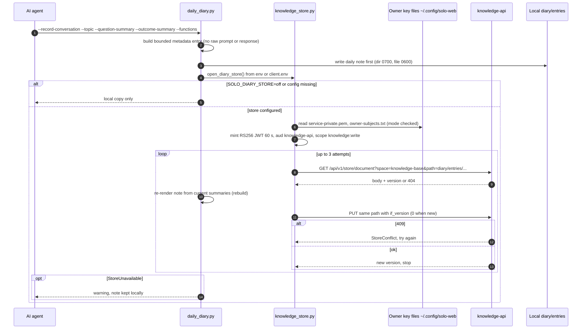
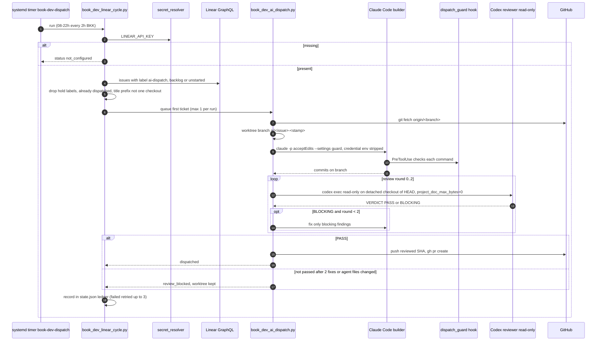
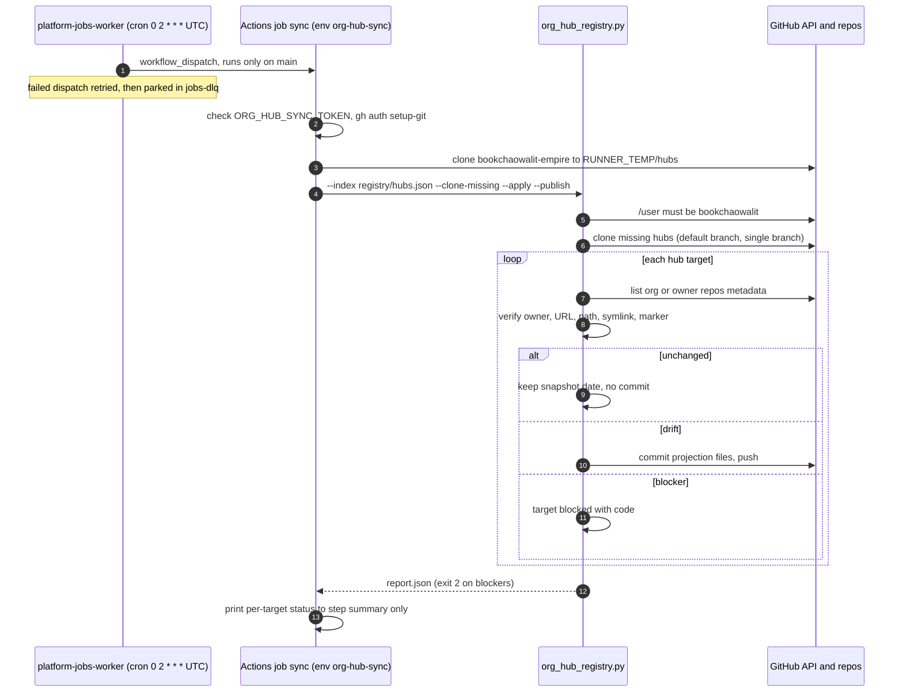
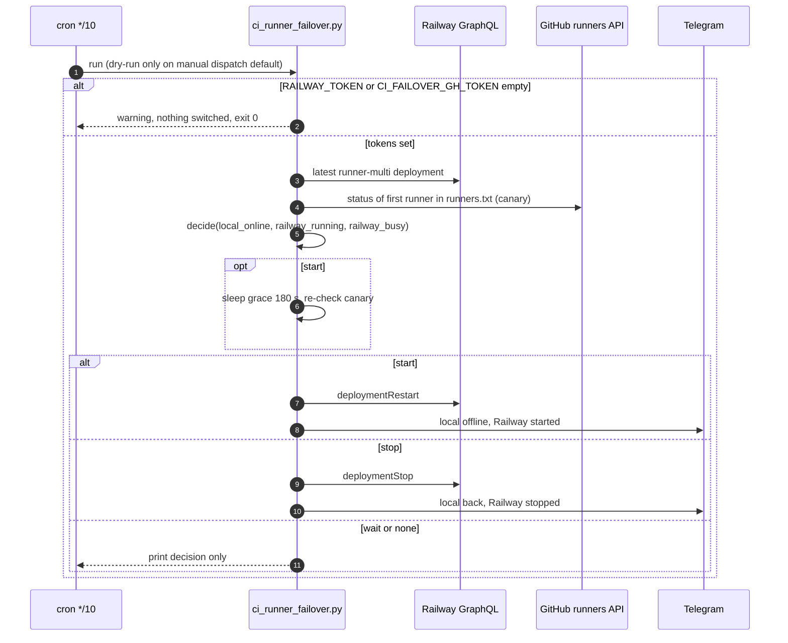

# 10 — Sequences

4 เส้นทางที่สำคัญที่สุด: diary write (ทำทุกวันโดย agent), Book Dev dispatch (เปลี่ยนโค้ดใน repo อื่น), org hub sync (push เข้า hub ทุกวัน), CI runner failover (ควบคุม Railway)

## 1. `task diary -- --record-conversation` → knowledge store

Sources: `infra/scripts/workflows/daily_diary.py` (`write_daily_diary`, `store.put(... if_version=...)`), `infra/scripts/utils/knowledge_store.py` (`AUDIENCE`, `SCOPES`, `/api/v1/store/document`, `StoreConflict`), `README.md` §Diary, commits `d10ae39`, `181bad8`, `3601004`

## 2. Book Dev Linear cycle (build → review → PR)

Sources: `infra/scripts/workflows/book_dev_linear_cycle.py`, `infra/scripts/workflows/book_dev_ai_dispatch.py` (build/review loop, `MAX_FIX_ROUNDS`, `open_pull_request`), `infra/scripts/workflows/book_dev_dispatch_guard.py`, `infra/scripts/workflows/install_book_dev_dispatch_timer.py` (`SCHEDULE`), `docs/operations/book-dev-linear-dispatch.md`

## 3. Org hub sync (GitHub Actions)

Sources: `.github/workflows/org-hub-sync.yml`, commit `5fdb2d9` (message: retry + jobs-dlq), `infra/scripts/sync/org_hub_registry.py`, `docs/operations/org-hub-registry-sync.md`

## 4. CI runner failover tick

Sources: `.github/workflows/ci-runner-failover.yml`, `infra/scripts/platform/ci_runner_failover.py` (`decide`, `main`, `notify`), `infra/ci-runner/local/runners.txt`, `infra/ci-runner/README.md`

## Open questions

- Diary: หลัง 409 ครบ 3 ครั้ง loop จบโดยไม่แจ้งเตือน (ไม่มี `else` หลัง `for`) ควรรายงานว่า upload ไม่สำเร็จหรือไม่
