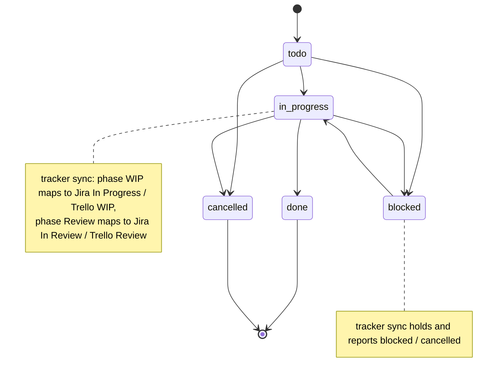
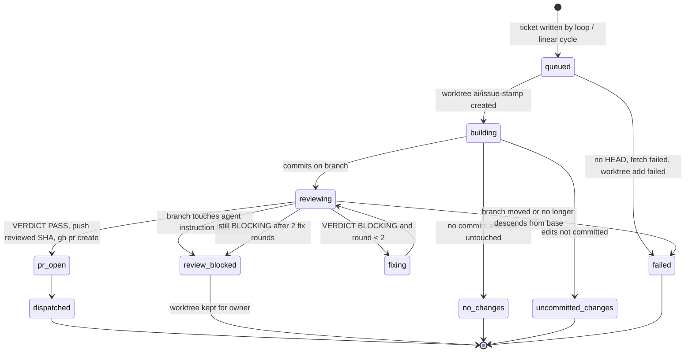
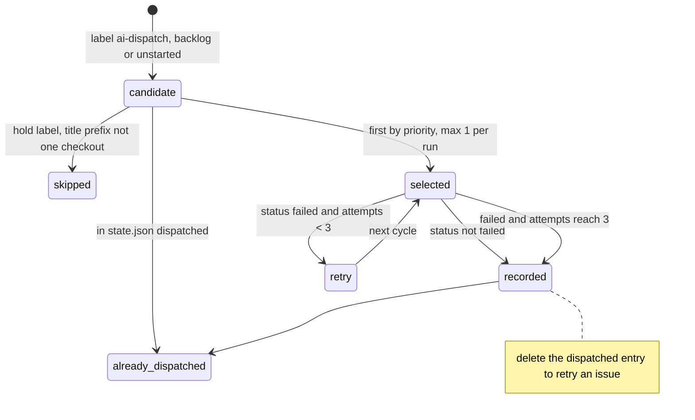
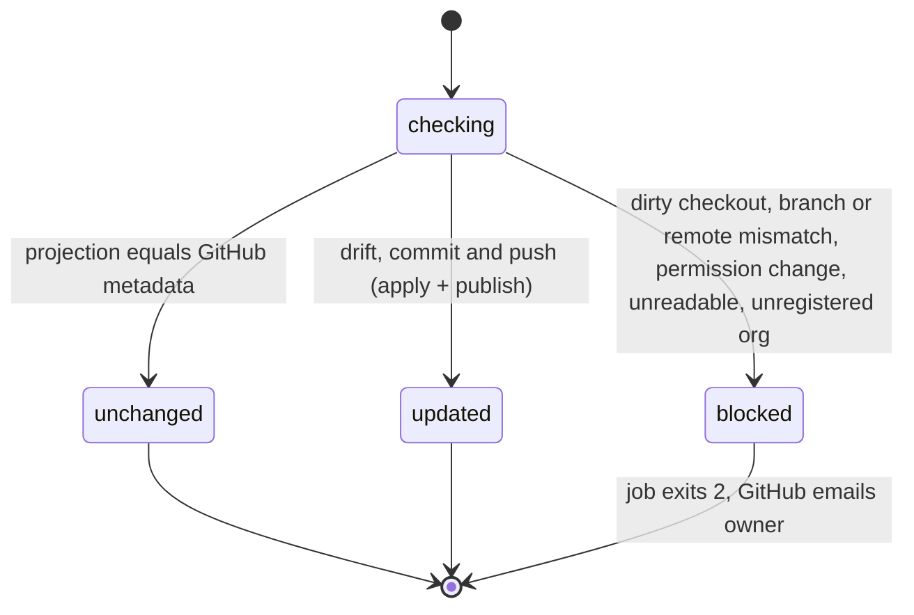
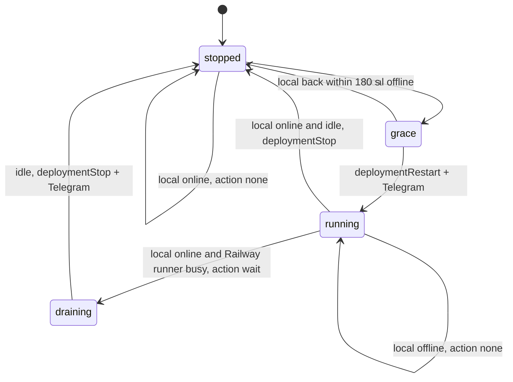

# 11 — State machines

Entity ที่มี status/lifecycle ในโค้ดของ repo นี้: Task (ผ่าน Tasks API และ tracker sync mapping), Book Dev ticket / dispatch outcome, Linear issue ใน dispatch ledger, org hub target, Railway runner-multi (failover)

## 1. Task status (มุมมอง client + tracker sync mapping)

ค่าที่อนุญาตมาจาก DDL ที่คัดลอกจาก control plane เดิม (`sqlite_tasks_schema.sql`); การ transition จริงบังคับฝั่ง Tasks API (ไม่อยู่ใน repo นี้)

Sources: `infra/tests/support/sqlite_tasks_schema.sql` (status CHECK), `docs/superpowers/specs/2026-10-14-tracker-sync.md` (mapping table), `infra/scripts/sync/tracker_sync.py`

## 2. Book Dev dispatch outcome (build-review flow)

Sources: `infra/scripts/workflows/book_dev_ai_dispatch.py` (returns `failed`, `no_changes`, `uncommitted_changes`, `review_blocked`, `dispatched`; `MAX_FIX_ROUNDS = 2`), `docs/operations/book-dev-linear-dispatch.md` §ผลลัพธ์ต่อ issue

## 3. Linear issue in the dispatch ledger

Sources: `infra/scripts/workflows/book_dev_linear_cycle.py` (`MAX_FAILED_ATTEMPTS = 3`, `state["dispatched"]`, `failed_attempts`), `docs/operations/book-dev-linear-dispatch.md`

## 4. Org hub target per run

Sources: `infra/scripts/sync/org_hub_registry.py`, `docs/operations/org-hub-registry-sync.md`, `.github/workflows/org-hub-sync.yml`

## 5. Railway runner-multi (watchdog view)

Sources: `infra/scripts/platform/ci_runner_failover.py` (`decide`, `--grace` 180), `infra/ci-runner/README.md` §Local primary

## Open questions

- Transition ที่ Tasks API อนุญาตจริง (เช่น `done` → `todo`) ไม่อยู่ใน repo นี้
