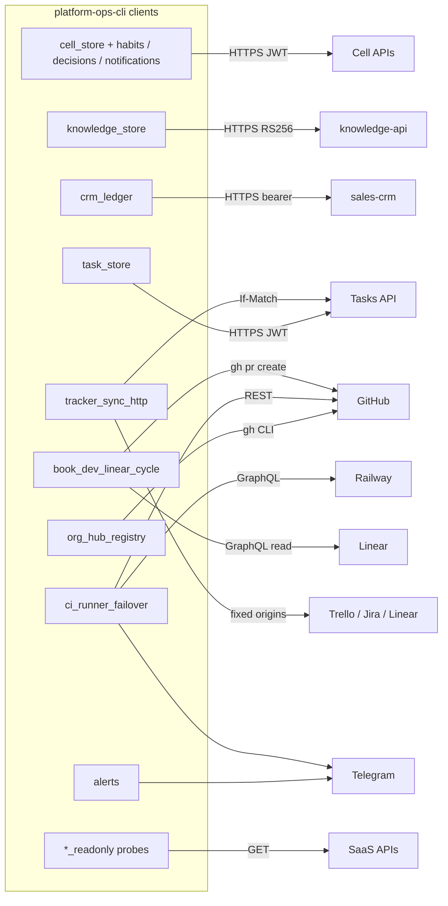

# 12 — API & integrations

repo นี้ **ไม่ expose endpoint ใด** (ไม่มี HTTP server) ทุกอย่างเป็น outbound client ด้านล่างคือ endpoint ภายนอกที่โค้ดเรียกจริง

## Internal platform APIs (outbound)

| API | Config key | Routes ที่เรียก | Auth | Client |
|---|---|---|---|---|
| Tasks API (empire-platform) | `EMPIRE_TASKS_API` | `/v1/tasks`, `/v1/tasks/number/{n}`, `/v1/tasks/external/{source}/{id}`, `/v1/tasks/stats`, `/v1/task-types`, `/v1/task-links`, `/v1/task-assignments`, `/v1/task-dependencies`, `/v1/task-role-suggestions` | automation JWT ต่อ caller, If-Match สำหรับ title | `utils/task_store.py` |
| Generic cells (goals, projects, roles-skills, automation, operating) | `EMPIRE_<CELL>_API` | `/v1/<plural>`, `/v1/<plural>/{id}`, `/v1/<plural>/stats` | automation JWT | `utils/cell_store.py` |
| Habits cell | `EMPIRE_HABITS_API` | `/v1/habits`, `/v1/habit-logs`, `/v1/routines`, `/v1/routine-logs`, `/v1/{kind}/stats` | automation JWT | `utils/habits_store.py` |
| Decisions cell | `EMPIRE_DECISIONS_API` | `/v1/decisions`, `/v1/decision-events`, `/v1/decision-reviews`, `/v1/decisions/dedupe/{key}` | automation JWT | `utils/decision_store.py` |
| Notifications cell | `EMPIRE_NOTIFICATIONS_API` | `/v1/notifications`, `/v1/notification-rules` | automation JWT | `utils/notifications_store.py` |
| knowledge-api | `EMPIRE_KNOWLEDGE_API` | `/api/v1/store/document?space&path` GET / PUT | RS256 60 s, aud `knowledge-api` | `utils/knowledge_store.py` |
| CRM ledger (sales-crm) | `EMPIRE_CRM_LEDGER_API` | `/revenue`, `/invoices`, `/clients` | CRM owner bearer | `utils/crm_ledger.py` |
| Intake | `EMPIRE_INTAKE_API` | — | — | อยู่ใน `CLIENT_CONFIG_KEYS` ของ `task_store.py` เท่านั้น ไม่มี client เรียก |

## External providers

| Provider | Origin ในโค้ด | ใช้ทำอะไร | Mode |
|---|---|---|---|
| GitHub | `api.github.com`, `gh` CLI | org hub sync, runner status, Actions usage, PR create | read + write (hub projections, PR) |
| Railway | `backboard.railway.com/graphql/v2` | `deploymentRestart` / `deploymentStop` ของ runner-multi | write |
| Linear | `api.linear.app` | ai-dispatch issues, tracker pilot block | read (+ pilot block write) |
| Trello / Jira | `api.trello.com`, `bookchaowalit.atlassian.net` | tracker sync pilot, allowlisted fields | write (allowlist) |
| Telegram | `api.telegram.org` | alerts (`TELEGRAM_NOTI_*` ก่อน), failover notices | send |
| Infisical | CLI / REST | secret resolution, rotations | read / write |
| Google | `oauth2.googleapis.com`, `gmail.googleapis.com`, `www.googleapis.com`, `sheets.googleapis.com` | Gmail categorizer/filters/digest, Calendar probe, Sheets | read / write ตาม script |
| Todoist, Strava | `api.todoist.com`, `www.strava.com` | goal → Todoist, Strava → habit logs | write |
| Read-only SaaS | Asana, Slack, Notion, Sentry, PostHog, Discord, Zoom, monday, MS Graph, WhatsApp (`graph.facebook.com`) | metadata probes (`integrations:*`) | read |
| Cloud | `api.cloudflare.com`, `api.vercel.com`, Neon, RunPod | usage, billing, DNS plan/apply, GPU worker | read (DNS apply = write) |
| Health probes | `api.stripe.com/v1/balance`, `mcp.project.cocofriday.com/mcp` และ provider อื่น | `sync/integration_health.py` ทดสอบการเชื่อมต่อ | read |
| MCP registry | `registry.modelcontextprotocol.io` | discover external apps | read |

Sources: `infra/scripts/utils/task_store.py`, `cell_store.py`, `habits_store.py`, `decision_store.py`, `notifications_store.py`, `knowledge_store.py`, `crm_ledger.py`, `infra/scripts/sync/*.py` (origins via `grep https://`), `infra/scripts/sync/tracker_sync_http.py`, `infra/scripts/platform/ci_runner_failover.py`, `infra/scripts/platform/cloud_read_adapters.py`, `infra/scripts/platform/cloudflare_dns.py`, `infra/scripts/platform/neon_projects.py`, `infra/scripts/utils/alerts.py`, `infra/tasks/integrations.yml`

## Open questions

- `EMPIRE_INTAKE_API` อยู่ใน client config keys แต่ไม่มี client: ตั้งใจเตรียมไว้หรือของค้าง
- `integration_health.py` probe `mcp.project.cocofriday.com` และ Stripe balance: ยังเป็นระบบที่ต้อง monitor หรือไม่
