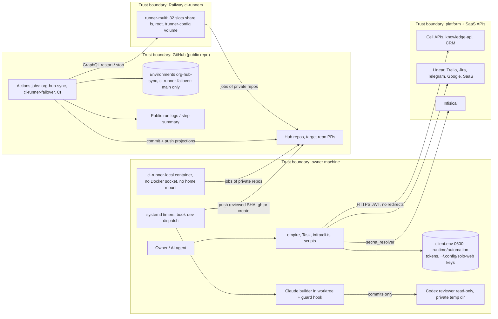

# 13 — Threat model (DFD + STRIDE)

ขอบเขต: เครื่องเจ้าของ (CLI, timers, local CI container), GitHub Actions ของ repo public นี้, Railway runner-multi และ API ปลายทาง ข้อมูลอ่อนไหวหลัก: automation tokens, owner key files สำหรับ knowledge JWT, PAT ใน env secrets, credential ของ provider, เนื้อหา diary

Sources: `infra/scripts/utils/task_store.py` (mode 0o077 checks, `_NoRedirect`), `infra/scripts/utils/knowledge_store.py`, `infra/scripts/utils/secret_resolver.py`, `infra/scripts/workflows/book_dev_ai_dispatch.py`, `infra/scripts/workflows/book_dev_dispatch_guard.py`, `docs/operations/book-dev-linear-dispatch.md`, `.github/workflows/*.yml`, `infra/ci-runner/README.md`, `infra/ci-runner/local/run.sh`

## STRIDE per element

| Element | Threat (STRIDE) | Mitigation ที่พบในโค้ด | Gap |
|---|---|---|---|
| client.env / token files / owner keys | **I** อ่านโดย user อื่น, **T** แก้ URL ชี้ไป host อื่น | ไฟล์ที่ group/world เข้าถึงได้ถูกปฏิเสธ (`st_mode & 0o077`), URL ต้อง https (http เฉพาะ loopback), ไม่ follow redirect เพื่อไม่ส่ง bearer ต่อ | ไม่มีการ pin host ที่อนุญาต: ใครเขียน client.env ได้ก็เปลี่ยนปลายทางได้ (ต้องเป็นเจ้าของไฟล์อยู่แล้ว) |
| Cell API calls | **S** ใช้ token ผิดหน้าที่, **R** ไม่รู้ว่าใครเขียน | token แยกต่อ automation, correlation ID ต่อรอบ, Tasks title write ใช้ If-Match | scope ของ token ตรวจฝั่ง server (นอก repo) |
| secret_resolver | **I** secret รั่วลง log/ไฟล์ | ค่าเก็บใน memory เท่านั้น, `infisical_secrets.py` ส่งค่าผ่านไฟล์ 0600 ชั่วคราวไม่ใช่ argv, Google OAuth error ถูกย่อเป็น code | — |
| Book Dev builder (Claude) | **E** สั่ง push/deploy/อ่าน credential, **T** แก้ไฟล์คำสั่ง reviewer | PreToolUse guard (git allowlist, ห้าม `gh`, cloud CLIs, เขียนนอก cwd), ตัด env ชื่อ credential, branch ที่แก้ `AGENTS*`/`CLAUDE*` → `review_blocked` | guard ตรวจข้อความ ไม่ใช่ OS sandbox: script ที่ builder เขียนเองหลบได้ (residual risk ที่ยอมรับ) |
| Codex reviewer | **T** ถูก steer โดยไฟล์ใน commit | detached checkout ใน temp dir 0700, `-c project_doc_max_bytes=0`, copy ผลกลับด้วย `O_NOFOLLOW` | — |
| PR to target repo | **E** merge โดยไม่ผ่านคน | dispatcher ไม่ merge/deploy; body ระบุว่าต้องให้เจ้าของอนุมัติ | ขึ้นกับ branch protection ของ repo ปลายทาง (นอก repo นี้) |
| Actions jobs | **I** log public, **E** fork / branch อื่นใช้ secret | guard `github.repository` + `refs/heads/main`, environment main-only, `permissions: contents: read`, `persist-credentials: false`, log เฉพาะสถานะต่อ target | `ORG_HUB_SYNC_TOKEN` เป็น classic PAT สิทธิ์กว้าง (admin:org, delete_repo …) ยังไม่ลดสิทธิ์ (ops record: org-hub-sync-hosted) |
| CI supply chain | **T** action / tool ถูกแก้ | actions pin SHA, reusable workflows pin `87dc5e1c`, Task binary ตรวจ SHA-256, Gitleaks / Semgrep / OSV / Trivy, Renovate | `format-check: false` (ไม่ใช่ security) |
| Railway runner-multi | **I/E** job หนึ่งอ่าน registration ของ runner อื่น | ยอมรับเพราะทุก repo มีเจ้าของเป็น collaborator เดียว, repo ลูกค้าห้ามเข้าร่วม, registration token อายุ 1 ชั่วโมงแล้วลบ | ไม่มีการแยกระหว่าง jobs ใน container เดียว |
| ci-runner-local | **I** job อ่าน credential บนเครื่องเจ้าของ | ไม่มี Docker socket, ไม่ mount home, จำกัด 8 GB / 6 CPU | `run.sh` เรียก Infisical `/github` PAT บน host เพื่อลงทะเบียน org runner (ไม่เข้า container) |
| Telegram alerts | **I** ข้อความหลุด | ข้อความคงที่ ไม่มีข้อมูลลับ; failover พิมพ์เพียงชื่อ exception เมื่อส่งไม่สำเร็จ | — |
| Diary | **I** prompt/response ส่วนตัวหลุด | บันทึกเฉพาะ metadata ที่ bounded, ไฟล์ 0600, ไม่ commit (git-ignored ใน knowledge-base), JWT 60 s | — |
| Tracker sync pilot | **T** แก้ข้อมูลเกิน allowlist | identity / marker ต้องตรง, allowlist field, journal + readback, dry-run default | ไม่มี atomic cross-provider transaction (ระบุใน spec) |

Sources: ตามตารางด้านบน, `docs/superpowers/specs/2026-10-14-tracker-sync.md`, `infra/scripts/utils/infisical_secrets.py`, `infra/scripts/utils/_http.py`, `infra/scripts/platform/ci_runner_failover.py` (`notify`), `.github/workflows/ci.yml`, `renovate.json`, ops record: org-hub-sync-hosted (2026-11-03)

## Open questions

- จะย้าย Book Dev builder เข้า OS sandbox (เช่น bubblewrap) ตามที่ doc แนะนำหรือไม่
- เมื่อไรจะ mint PAT แบบ `repo` + `read:org` เพื่อแทน `ORG_HUB_SYNC_TOKEN` ตัวปัจจุบัน
