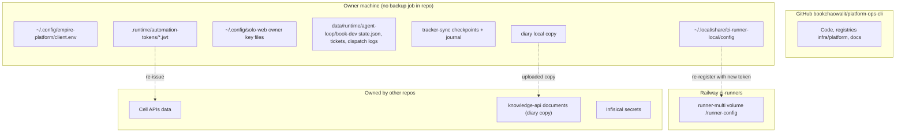

# 14 — Backup & DR

repo นี้ไม่เป็นเจ้าของข้อมูลธุรกิจ (ดู [09](09-erd.md)): tasks, goals, habits, decisions อยู่ใน cell APIs, ledger อยู่ใน sales-crm, diary อยู่ใน knowledge-api backup ของข้อมูลเหล่านั้นเป็นหน้าที่ของ repo เจ้าของ ไม่มี workflow backup ใน repo นี้
สิ่งที่ repo นี้ต้องกู้เองคือ code, config บนเครื่องเจ้าของ, local runtime state และ CI runner registrations

| Asset | อยู่ที่ | Backup จริง | วิธีกู้ (จากเอกสาร repo) |
|---|---|---|---|
| Code / registries | GitHub | Git (history ก่อน 2026-10-11 อยู่ใน `solo-empire`) | clone ใหม่ |
| client.env | เครื่องเจ้าของ | ไม่มี | เขียนใหม่ด้วย `tasks_backend.py use-api --url ...`; ค่าไม่ลับ |
| Automation tokens, owner key files | เครื่องเจ้าของ | ไม่มีใน repo | re-issue จาก identity / empire-platform (นอก repo) |
| Diary | local + knowledge-api | local copy + store version history (ops record: hosted-document-store) | pull จาก store |
| Book Dev ledger / tickets | `data/runtime/agent-loop/book-dev/` | ไม่มี | ถ้าหาย issue ที่เคยส่งแล้วอาจถูกส่งซ้ำ (ledger คือกลไกกันซ้ำ) |
| Tracker sync checkpoints / journal | state dir | ไม่มี | spec กำหนด recover lost ack ด้วย readback เมื่อ output ตรงกับ intent |
| Local runner registrations | `~/.local/share/ci-runner-local/config` | ไม่มี | `local/run.sh up` ลงทะเบียน runner ที่ขาด |
| Railway runner registrations | volume `/runner-config` | ไม่มี | volume หาย / registration ถูกลบ: ใช้ volume ว่าง, ตั้ง `RUNNER_TOKEN` ใหม่, redeploy (`infra/ci-runner/README.md`) |
| Secrets | Infisical | นอก repo | — |

- **RTO / RPO:** not defined (ไม่มีในเอกสาร repo)
- DR ของ CI host คือ failover เอง: local offline → Railway ใน ~65 s (วัด 2026-11-03 ตาม README) ถ้าทั้งสองล่ม GitHub จะคิว job self-hosted ได้ถึง 24 ชั่วโมง
- `Makefile clean` ลบ `data/backups/*.db.gz` ซึ่งเป็นของเหลือจาก SQLite เดิม ไม่มี script ใดสร้างไฟล์นี้แล้ว

Sources: `infra/scripts/utils/tasks_backend.py`, `infra/scripts/utils/task_store.py`, `infra/scripts/workflows/book_dev_linear_cycle.py`, `docs/operations/book-dev-linear-dispatch.md`, `docs/superpowers/specs/2026-10-14-tracker-sync.md`, `infra/ci-runner/README.md`, `infra/ci-runner/local/run.sh`, `Makefile`, `README.md`, ops record: hosted-document-store (2026-11-03)

## Open questions

- ควร backup `data/runtime/agent-loop/book-dev/linear/state.json` หรือไม่ (หายแล้วเสี่ยง dispatch ซ้ำ)
- RTO/RPO ของงาน ops (เช่น org hub sync หยุดได้นานเท่าไร) ยังไม่กำหนด
