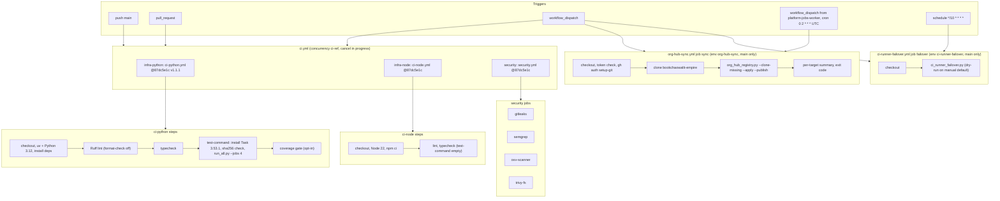

# 15 — CI/CD pipeline

3 workflows ใน `.github/workflows/` ไม่มี CD job (repo ไม่ deploy) ภาพ runner image ที่ build ด้วยมือแยกไว้ที่ [16](16-deployment.md)

| Workflow | Trigger | Runner | Secrets | ผลล่าสุด 90 วัน (`gh run list`) |
|---|---|---|---|---|
| `ci.yml` | push main, PR, dispatch | GitHub-hosted (reusable default `ubuntu-24.04`) | — | 59 runs (ทุก branch): 52 success, 6 failure, 1 cancelled (เริ่ม 2026-10-17) |
| `org-hub-sync.yml` | `workflow_dispatch` only (jobs queue 02:00 UTC ตั้งแต่ `5fdb2d9`; ก่อนหน้านั้น `schedule`) | `ubuntu-24.04` | `ORG_HUB_SYNC_TOKEN` | 8 runs: 8 success (เริ่ม 2026-10-28) |
| `ci-runner-failover.yml` | */10, dispatch | `ubuntu-24.04` | `RAILWAY_TOKEN`, `CI_FAILOVER_GH_TOKEN`, `TELEGRAM_*` | 2 runs: 1 dispatch + 1 schedule (เริ่ม 2026-11-03) |

ไม่มี `needs:` ระหว่าง jobs ใน `ci.yml`: ทั้ง 3 jobs รันขนานกัน

Sources: `.github/workflows/ci.yml`, `.github/workflows/org-hub-sync.yml`, commit `5fdb2d9`, `.github/workflows/ci-runner-failover.yml`, `.task-version`, platform-ci-workflows `.github/workflows/ci-python.yml`, `ci-node.yml`, `security.yml` @ `87dc5e1c`, `gh run list --repo bookchaowalit/platform-ops-cli --limit 300` (2026-11-03)

## Open questions

- Failover cron ทุก 10 นาที แต่มี scheduled run เพียง 1 ครั้งในวันแรก: GitHub ไม่รับประกันความถี่ของ schedule สั้น ๆ ควรเช็คต่อหรือย้ายไปที่อื่น
- `ci.yml` ไม่มี branch protection / required checks ให้ตรวจจากใน repo
