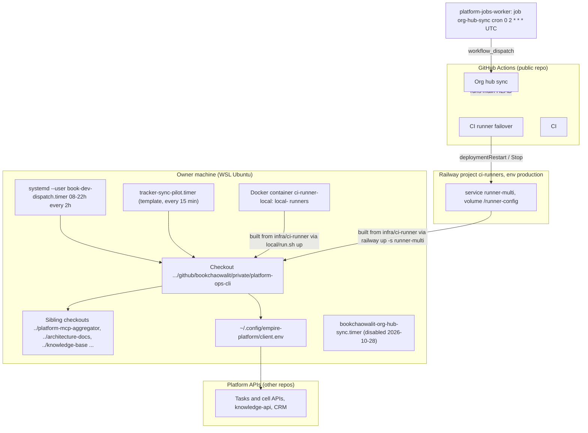

# 16 — Deployment

repo นี้ **ไม่มี hosted runtime ของตัวเอง** ("Not deployed: runs on the owner's machine and in CI", `PRODUCT.md`) สิ่งที่ "ถูกติดตั้ง" มี 4 แบบ: checkout บนเครื่องเจ้าของ, jobs บน GitHub Actions ที่รันจาก `main`, local systemd timers และ CI runner image บน Railway / Docker local

| Target | ติดตั้งอย่างไร | Trigger การ "deploy" | หลักฐาน |
|---|---|---|---|
| Checkout เจ้าของ | `git pull`; `task install` (npm ci ใน `infra/`) | manual | `README.md`, `Taskfile.yml` |
| Actions jobs | อ่าน workflow + script จาก `main` ทุก run; org hub sync ถูก dispatch จาก jobs queue (ตั้งแต่ `5fdb2d9`) | push main มีผลรอบถัดไปทันที | `.github/workflows/*.yml`, commit `5fdb2d9` |
| book-dev-dispatch timer | `task book-dev:linear:timer -- --activate` เขียน units + `~/.config/book-dev-dispatch.env` | manual reinstall | `install_book_dev_dispatch_timer.py` |
| Tracker sync timer | `install_tracker_sync_timer.py` หลัง preflight ผ่าน | manual | `infra/templates/tracker-sync/` |
| Local CI runners | `infra/ci-runner/local/run.sh up` | manual | `infra/ci-runner/local/run.sh` |
| Railway runner-multi | `npx -y @railway/cli@latest up --detach -s runner-multi` จาก `infra/ci-runner` | manual (CI ไม่ build image) | `infra/ci-runner/README.md`, คอมเมนต์ใน `ci.yml` |

Environment / config ที่สำคัญ (ชื่อเท่านั้น): `SOLO_EMPIRE_TASKS_BACKEND`, `EMPIRE_*_API`, `EMPIRE_CLIENT_CONFIG`, `SOLO_*_ROOT`, `SOLO_DIARY_STORE`, `SOLO_WEB_PUBLIC_ORIGIN`, `SECRETS_PROVIDER`; Railway `RUNNERS` (ต้องเรียงตรงกับ `local/runners.txt`) ไม่มี custom domain ใด ๆ ของ repo นี้

Sources: `PRODUCT.md`, `README.md`, `Taskfile.yml`, `infra/tasks/portfolio.yml` (`book-dev:linear:timer`, `hubs:timer`), `infra/scripts/workflows/install_book_dev_dispatch_timer.py`, `infra/scripts/sync/install_tracker_sync_timer.py`, `infra/scripts/sync/install_org_hub_timer.py`, `infra/templates/tracker-sync/*`, `infra/ci-runner/README.md`, `infra/ci-runner/local/run.sh`, `infra/scripts/platform/ci_runner_failover.py` (project / env / service ids), `.github/workflows/*.yml`, `infra/scripts/utils/secret_resolver.py`, ops record: org-hub-sync-hosted (2026-11-03), ops record: book-dev-build-review-flow (2026-11-03)

## Open questions

- book-dev-dispatch timer ถูก activate บนเครื่องแล้ว (ตาม ops record 2026-11-01) แต่สถานะจริงตรวจได้จาก `systemctl --user` เท่านั้น ไม่มีใน repo
- Railway image ที่รันอยู่ตรงกับ commit ใดของ `infra/ci-runner` (ไม่มีการบันทึก version ของ image)
