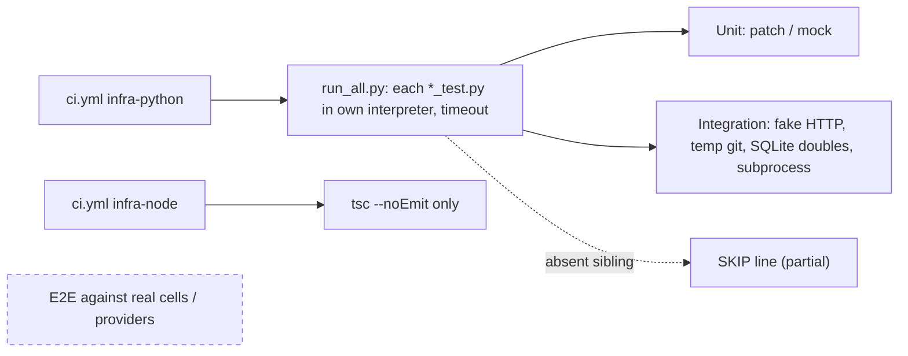

# 17 — Test coverage matrix

Test ทั้งหมดเป็น Python script `infra/tests/**/*_test.py` (127 ไฟล์ใน 16 โฟลเดอร์ที่มี test) รันทีละไฟล์ด้วย `infra/tests/run_all.py` แบบ offline ไม่มี TypeScript test (ใช้ `tsc --noEmit` อย่างเดียว) และไม่มี e2e ที่แตะระบบจริง
การแบ่งระดับในตารางนี้ใช้เทคนิคที่เห็นในไฟล์: **unit** = เรียกฟังก์ชันตรงกับ patch/mock, **integration** = fake HTTP server (`HTTPServer`), Git repo จริงใน temp dir, SQLite store doubles หรือรัน CLI ผ่าน subprocess, **e2e** = แตะ provider / cell จริง

| Feature | Unit | Integration | E2E | Test files (ตัวอย่าง) |
|---|---|---|---|---|
| Tasks API store + writers/readers | ✓ | ✓ SQLite double, fake HTTP (`client_config_test`) | — | `tests/tasks/*` (12) |
| Cell probe / monitor health | ✓ | ✓ fake HTTP | — | `tests/platform/cell_probe_test.py`, `monitor_health_test.py` |
| Diary daily / summary / store | ✓ patch store | ✓ SQLite double | — | `tests/diary/*` (3) |
| Decisions | ✓ | ✓ SQLite double | — | `tests/decisions/*` (3) |
| Habits, life check-in, goals mapping, season quest | ✓ | ✓ SQLite double | — | `tests/quality/habit_*`, `life_checkin_test.py`, `goal_portfolio_mapping_test.py` |
| Org hub sync | ✓ | ✓ real git in temp | — (hosted runs act as live check) | `tests/integrations/org_hub_registry_test.py`, `org_hub_timer_test.py` |
| Tracker sync pilot | ✓ | ✓ fake provider HTTP | — | `tests/integrations/tracker_sync_test.py`, `tracker_sync_timer_test.py` |
| Book Dev loop / dispatch / guard / linear cycle | ✓ | ✓ real git worktrees, subprocess | — | `tests/agent/book_dev_*` (5) |
| CI runner failover decision | ✓ (7 cases) | — | — | `tests/platform/ci_runner_failover_test.py` |
| Read-only SaaS probes | ✓ patch HTTP | — | — | `tests/integrations/*_readonly_test.py` (10) |
| Alert delivery (Telegram) | ✓ patch `urlopen` | — | — | `tests/integrations/alert_delivery_test.py` |
| Secrets / auth resolver / scan | ✓ | ✓ real git (`scan_secrets_test`) | — | `tests/security/*` (6), `tests/platform/auth_resolver_test.py` |
| Platform registries, cloud usage, PaaS, GPU, LLM budget | ✓ | — | — | `tests/platform/*` (30 total) |
| `empire` facade, Task ownership / parity | — | ✓ subprocess (needs Task binary) | — | `tests/quality/empire_cli_facade_test.py`, `task_command_ownership_test.py` |
| Contract / doc guards | ✓ | sibling checkout (skip when absent) | — | `tests/quality/*_guard_test.py`, `docpack_coverage_test.py` |
| Learning, media, SEO, finance, R&D | ✓ | ✓ SQLite double (บางไฟล์) | — | `tests/learning/*`, `media/*`, `seo/*`, `finance/*`, `rnd/*` |
| Owner CLI `infra/cli.ts` | — (typecheck only) | — | — | **gap** |
| Knowledge store live round-trip | — | — | — | **gap** (tests บังคับ `SOLO_DIARY_STORE=off`) |
| CI runner image (`Dockerfile`, `multi-runner.sh`, `job-cleanup.sh`, `run.sh`) | — | — | — | **gap** (CI ไม่ build image) |
| Railway GraphQL / GitHub runner API calls in failover | — | — | — | **gap** (เทสต์เฉพาะ `decide()` / runners file) |

Sources: `infra/tests/` (directory listing, `grep HTTPServer`, `grep git`, `grep sqlite_`), `infra/tests/run_all.py`, `infra/tests/README.md`, `infra/tests/platform/ci_runner_failover_test.py`, `infra/package.json` (`test` script), `.github/workflows/ci.yml`

## Open questions

- `infra/tests/rnd/rnd_pipeline_test.py` ถูกบันทึกว่าล้มมาก่อนแล้ว (ops record: book-dev-build-review-flow) ยังล้มอยู่หรือไม่ (ไม่ได้รันใน pack นี้)
- ควรมี smoke test ของ `infra/cli.ts` อย่างน้อย `--help` / `delivery overview` กับ fixture หรือไม่
