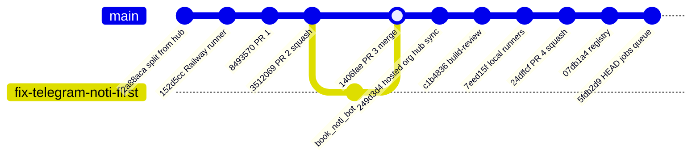
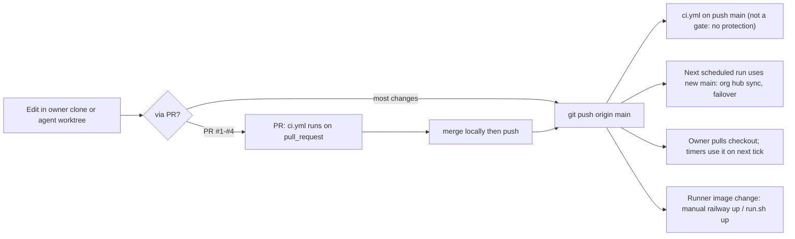

# 18 — Git & release workflow

"Production" ของ repo นี้คือ `main`: scheduled jobs บน Actions รันจาก `main` ทุกรอบ และ checkout ของเจ้าของ `git pull` จาก `main` ไม่มี tag หรือ release
ในทางปฏิบัติ งานส่วนใหญ่ commit ตรงเข้า `main`: 98 commits ใน 90 วัน มี PR เพียง 4 (#1–#4) และ merge commit 1 (PR #3) `main` ไม่มี branch protection หรือ ruleset (`gh api .../branches/main/protection` → 404, rulesets ว่าง)

กติกาจาก memory ของเจ้าของ: merge ใน local clone แล้ว push (ไม่ใช้ `gh pr merge`) และงาน AI (Book Dev) ต้องผ่าน PR ที่เจ้าของ merge เอง (ADR-0005) ส่วนการแก้ repo นี้เองไม่มีกติกาบังคับใน repo

Sources: `git log origin/main --since=90.days` (98 commits), `git log --merges`, `gh pr list --state all`, `gh api repos/bookchaowalit/platform-ops-cli/branches/main/protection`, `gh api .../rulesets`, `.github/workflows/*.yml`, `infra/ci-runner/README.md`, [08-adr/ADR-0005](08-adr/ADR-0005-book-dev-build-review-pr-gate.md)

## Open questions

- ควรเปิด branch protection / required check `CI` บน `main` หรือไม่ เพราะ scheduled jobs ใช้ `main` ทันที (5 จาก 53 push runs บน main ล้ม, ดู [22](22-dora.md))
