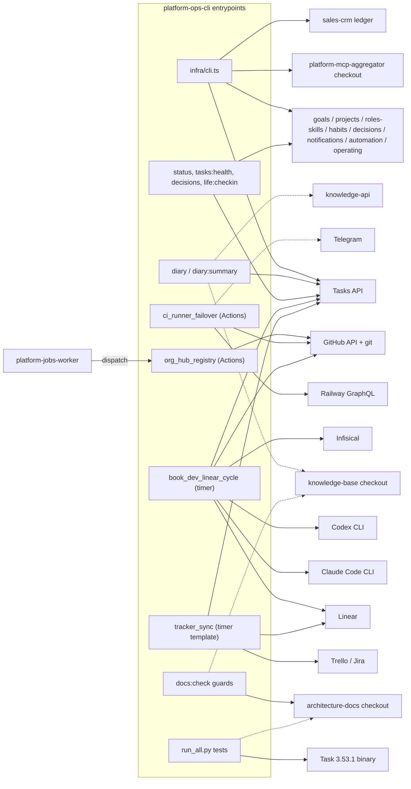

# 19 — Service dependency map

Runtime dependency ของ entrypoints ในวันนี้ เส้นทึบ = ต้องมีเพื่อให้งานสำเร็จ, เส้นประ = optional / fallback

| Dependency | ถ้าไม่มี |
|---|---|
| `platform-mcp-aggregator` checkout | `infra/cli.ts` โหลด module ไม่ได้ |
| `client.env` / `EMPIRE_*_API` | `ClientConfigError`; ไม่มี default |
| Automation token ของ caller | `no token for automation ...` |
| `LINEAR_API_KEY` | Book Dev cycle `not_configured` (สถานะปัจจุบันตาม ops record) |
| `RAILWAY_TOKEN` / `CI_FAILOVER_GH_TOKEN` | failover พิมพ์ warning แล้วจบ 0 |
| `ORG_HUB_SYNC_TOKEN` | job ล้มทันที (`::error::`) |
| platform-jobs-worker | org hub sync ไม่ถูกเรียก (ไม่มี `schedule` สำรองแล้ว) ต้อง `gh workflow run` เอง |
| Sibling checkouts | tests / guards SKIP (partial) |
| knowledge-api | diary เก็บเฉพาะ local พร้อม warning |

Sources: `infra/cli.ts`, `infra/mcp-modules.ts`, `infra/scripts/utils/task_store.py`, `infra/scripts/utils/cell_store.py`, `infra/scripts/utils/knowledge_store.py`, `infra/scripts/utils/crm_ledger.py`, `infra/scripts/workflows/daily_diary.py`, `infra/scripts/workflows/book_dev_linear_cycle.py`, `infra/scripts/workflows/book_dev_ai_dispatch.py`, `infra/scripts/sync/org_hub_registry.py`, `infra/scripts/sync/tracker_sync.py`, `infra/scripts/platform/ci_runner_failover.py`, `.github/workflows/*.yml`, commit `5fdb2d9`, `Taskfile.yml`, `README.md` §Sibling repositories, ops record: book-dev-build-review-flow (2026-11-03)

## Open questions

- Hostnames จริงของ cell APIs อยู่ใน `client.env` บนเครื่อง (ไม่อยู่ใน repo) จึงไม่ได้ระบุว่าไปผ่าน gateway หรือ direct
