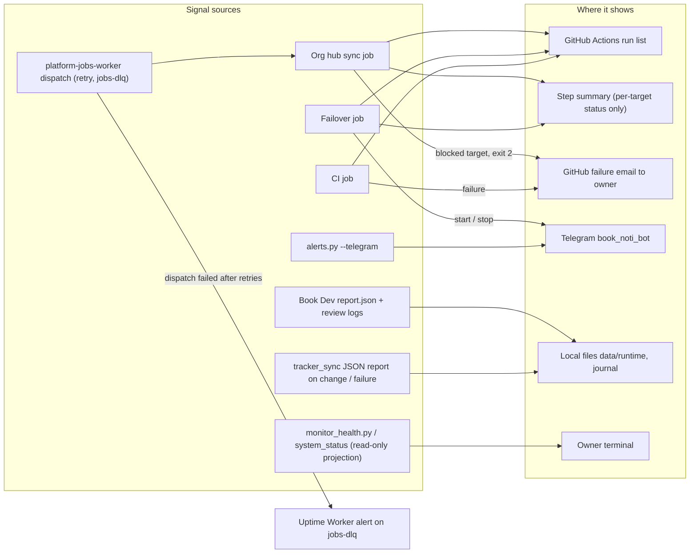

# 20 — Observability

repo นี้ **ไม่มี Sentry SDK, PostHog หรือ heartbeat ping ของตัวเอง** (`grep sentry_sdk|heartbeat` ใน `infra/scripts` เจอเพียง `.env.example` และ `monitor_health.py` ที่ *อ่าน* สถานะระบบอื่น) สัญญาณที่มีจริงคือ GitHub Actions run status, step summary, Telegram จาก failover และ alerts, และ JSON reports บนเครื่อง

| สิ่งที่ถูกเฝ้าดู | สัญญาณ | ค่าที่สังเกตได้ (2026-11-03) |
|---|---|---|
| Org hub registry drift | job status + summary | 8/8 success ตั้งแต่ 2026-10-28 (`gh run list`) |
| Local CI runner online | failover decision line + Telegram เมื่อ switch | 2 runs (1 schedule) ตั้งแต่ 2026-11-03 04:18 UTC; no-op จนกว่าจะมี `RAILWAY_TOKEN` |
| Code health | CI on push main | 53 push runs บน main, 5 failure (ดู [22](22-dora.md)) |
| Daily alerts (tasks overdue ฯลฯ) | `alerts.py` → Telegram (`TELEGRAM_NOTI_*` ก่อน, fallback `TELEGRAM_*`) | ไม่มี scheduler ใน repo เรียก `alerts.py` |
| Book Dev dispatch | `report.json` `status` ต่อ issue, journal ของ timer | ดูได้จาก `journalctl --user` บนเครื่องเท่านั้น |
| Platform health projection | `monitor_health.py`: loopback health GETs, aggregate reads | อ่าน `data/generated/briefings/scraping-collection-health.json` |

Sources: `.github/workflows/org-hub-sync.yml`, commit `5fdb2d9`, `.github/workflows/ci-runner-failover.yml`, `.github/workflows/ci.yml`, `infra/scripts/utils/alerts.py`, `infra/scripts/platform/ci_runner_failover.py` (`notify`), `infra/scripts/platform/monitor_health.py`, `infra/scripts/workflows/book_dev_ai_dispatch.py`, `docs/superpowers/specs/2026-10-14-tracker-sync.md` §Runtime, `docs/operations/org-hub-registry-sync.md`, `gh run list` (2026-11-03)

## Open questions

- Failover ยังใช้ GitHub schedule และไม่ส่ง heartbeat: ถ้า GitHub ข้ามรอบหรือปิด schedule (60 วันไม่มี commit) จะไม่มีใครรู้ ควรย้ายเข้า jobs queue แบบเดียวกับ org hub sync หรือไม่
- Org hub sync ที่ dispatch สำเร็จแต่ job ล้ม ยังแจ้งผ่าน GitHub email เท่านั้น (jobs-dlq จับเฉพาะ dispatch ที่ล้ม ตาม commit `5fdb2d9`)
- Book Dev timer ล้ม (เช่น `not_configured`) ไม่มี alert ออกนอกเครื่อง
- ใครเรียก `alerts.py --telegram` ตามรอบ (ไม่พบใน repo นี้)
