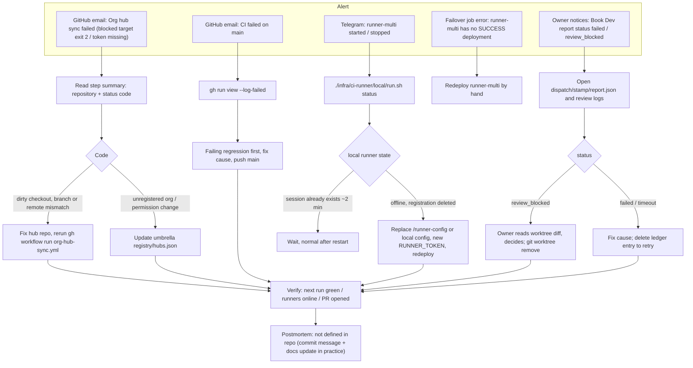

# 21 — Incident response

repo นี้ไม่มี runbook incident หรือ postmortem template ของตัวเอง flow ด้านล่างประกอบจากช่องแจ้งเตือนที่มีจริง (GitHub failure email, Telegram, exit codes) และขั้นตอนกู้ที่เขียนไว้ใน `infra/ci-runner/README.md`, `docs/operations/org-hub-registry-sync.md` และ `docs/operations/book-dev-linear-dispatch.md`
หลักการแก้ defect มาจาก `README.md` §Quality gate: บันทึก flow/preconditions → เขียน regression ที่ล้มก่อน → แก้ที่สาเหตุ → รัน journey ที่กระทบ ห้ามเพิ่ม retry/exclusion เพื่อให้เขียว

| Severity / ช่อง | ใครถูกแจ้ง | อยู่ที่ |
|---|---|---|
| Actions job failure | Owner (GitHub email) | GitHub notification settings |
| CI host switch | Owner (Telegram book_noti_bot) | `ci_runner_failover.py` `notify` |
| Book Dev / tracker sync | ไม่มี push alert, ดู report/journal บนเครื่อง | `data/runtime/...`, `journalctl --user` |

Sources: `.github/workflows/org-hub-sync.yml`, `.github/workflows/ci-runner-failover.yml`, `infra/scripts/platform/ci_runner_failover.py`, `infra/ci-runner/README.md` (§Registration and credentials, §Several runners), `docs/operations/org-hub-registry-sync.md`, `docs/operations/book-dev-linear-dispatch.md`, `README.md` §Quality gate, ops record: ci-hosting-policy (2026-11-03)

## Open questions

- Severity levels, เวลาตอบสนองที่คาดหวัง และ postmortem template ยังไม่กำหนด
- Incident ของงาน ops ควรสร้าง task ใน Tasks API อัตโนมัติ (แบบ backlog-sync ใน platform-empire) หรือไม่
