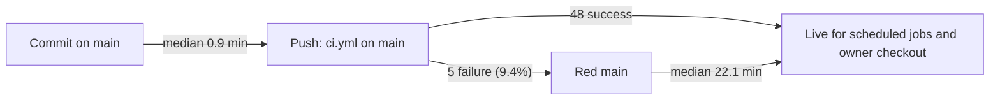

# 22 — DORA metrics

**นิยาม "deployment" ของ repo นี้:** repo ไม่ deploy service (ดู [16](16-deployment.md)) แต่ scheduled jobs และ checkout ของเจ้าของใช้ `main` ทันที จึงนับ **push เข้า `main` ที่มี `ci.yml` run** เป็นหนึ่ง deployment และนับ **CI run บน `main` ที่ `failure`** เป็น failed deployment (proxy) การ build/redeploy runner image ด้วยมือ (`railway up`, `run.sh up`) ไม่มีบันทึกใน repo จึงไม่นับ

ช่วงเวลา: 90 วันถึง 2026-11-03 แต่ history ของ repo เริ่ม 2026-10-11 (split จาก hub) และ `ci.yml` เริ่มรัน 2026-10-17 ค่าทุกตัวจึงครอบคลุมเพียง ~18 วัน (2026-10-17 → 2026-11-03) ณ HEAD `5fdb2d9`

| Metric | วิธีวัดสำหรับ repo นี้ | ค่าปัจจุบัน | Command |
|---|---|---|---|
| Deployment frequency | จำนวน push-to-main CI runs (ไม่นับ cancelled) / ช่วงเวลา | **53 deploys ใน 10 วันที่มี push** (18 วันปฏิทิน) ≈ 2.9 / วันปฏิทิน; 98 commits ใน 90 วัน | (A), (B) |
| Lead time for changes | committer time ของแต่ละ commit → `updatedAt` ของ CI success แรกบน `main` ที่มี commit นั้น | **median 0.9 นาที, p90 12.2 นาที, max 231.9 นาที** (60 commits ตั้งแต่ 2026-10-17) | (C) |
| Change fail rate | CI `failure` บน `main` / push runs | **5 / 53 = 9.4%** | (A) |
| Failed deployment recovery time | `createdAt` ของ run ที่ล้มครั้งแรก → `updatedAt` ของ success ถัดไปบน `main` | **4 ครั้ง: 23.7, 20.5, 4.9, 231.8 นาที; median 22.1 นาที** | (D) |
| Deployment rework rate | ไม่มีบันทึก "unplanned deployment due to incident" จึงใช้ proxy: push ที่ head commit เป็น `fix…` | **proxy 32 / 53 = 60%** (และ 47 / 98 commits ขึ้นต้น `fix`) — เป็นค่าบนที่หยาบ เพราะ `fix` ส่วนหนึ่งคือแก้ตาม review ก่อนใช้งาน ไม่ใช่ rework หลัง deploy | (E) |

Commands (รันจาก worktree, 2026-11-03):

```bash
# (A) push runs on main, conclusions
gh run list --repo bookchaowalit/platform-ops-cli --workflow ci.yml --branch main --event push --limit 200 \
  --json conclusion,createdAt,updatedAt,headSha
# (B) commits in the 90-day window
git log origin/main --since=90.days --oneline | wc -l
# (C) per commit: first successful main run whose headSha contains the commit
#     (git merge-base --is-ancestor <commit> <run sha>), minutes from committer date to run updatedAt
git log origin/main --since=2026-10-17 --format='%H %cI'
# (D) walk (A) sorted by createdAt: first failure -> next success
# (E) subject of each run head
git log -1 --format=%s <headSha>
```



Sources: `gh run list` (ci.yml, branch main, event push), `git log origin/main`, `.github/workflows/ci.yml`, `README.md` (split date)

## Caveats

- ไม่มี branch protection: failure บน `main` คือโค้ดที่ scheduled jobs อาจใช้ไปแล้ว (เช่น failure `3601004` ค้าง 3 ชม. 52 นาที)
- Lead time สั้นเพราะ commit ถูก push ทันทีและ CI ใช้ ~50 วินาที; ไม่มีขั้น review สำหรับงานส่วนใหญ่ (ดู [18](18-git-release-workflow.md))
- ช่วงข้อมูลสั้น (~18 วัน) ค่าเปลี่ยนเร็ว

## Open questions

- ควรนับการ redeploy runner image และการติดตั้ง timer ใหม่เป็น deployment หรือไม่ (ต้องมีบันทึก เช่น tag หรือ log)
- ต้องการนิยาม rework rate ที่ดีกว่า proxy `fix` หรือไม่ (เช่น label incident บน commit/issue)
